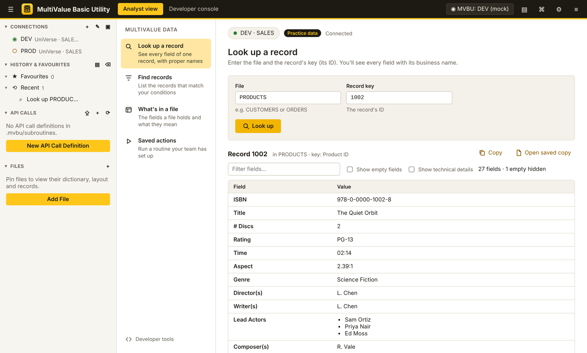
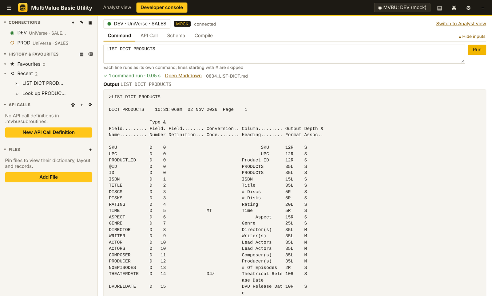

# MultiValue Basic Utility (MVBU) for Chrome and Edge

The Chrome and Edge edition of MultiValue Basic Utility (MVBU) for Rocket **UniVerse** and **UniData**. It has the same Analyst view and Developer console as the VS Code extension, in a browser tab. It also works in Chromium and Brave.



## How it works

A browser cannot open the UniRPC connection that UniVerse and UniData use, so MVBU for Chrome has two parts:

| Part | Folder | Role |
|---|---|---|
| Extension | `ext/` | The MVBU page: side bar, Analyst view, Developer console, settings and saved output |
| Helper | `host/` | The same Python helper as the VS Code extension, using Rocket uopy. Chrome starts it through *native messaging* when the MVBU page opens, and stops it when the page closes. |

```
MVBU page (Chrome)  ──native messaging──▶  MVBU helper (Python + uopy)  ──UniRPC / SSL──▶  UniVerse / UniData
```

Nothing is installed on the database server.

## Requirements

| Component | Requirement |
|---|---|
| Browser | Google Chrome, Microsoft Edge, Chromium or Brave, version 116 or later |
| Operating system | Windows 10 or 11, macOS, or Linux |
| Python | 3.8 or later |
| Rocket uopy | `python3 -m pip install uopy` (Windows: `python -m pip install uopy`) |
| Database server | UniVerse or UniData, with the UniRPC service reachable (default port 31438) and SSL enabled |

## Installation

Install once on each computer. Unpack `mvbu-chrome-<version>.zip` to a permanent folder first, because the browser loads the extension from that folder.

### 1. Register the helper

**Windows**: double-click `host\install-chrome-host.cmd`. It runs the installer with Python, not PowerShell, so it works where company policy only allows signed PowerShell scripts.

**macOS and Linux**: in a terminal, run:

```bash
cd mvbu-chrome/host
./install-chrome-host.sh
```

Both run the same installer, `host/install_chrome_host.py`. It:

- finds a Python 3 that has uopy installed;
- copies the helper (`mvbu_native_host.py`, `mvbu_helper.py` and the `mock` sample data) to the install folder below;
- writes a small launcher there that records that Python;
- registers the helper with Chrome, plus Chromium, Edge and Brave where they are installed.

It needs no administrator rights. The helper runs from the install folder, so the unpacked package can be moved or deleted afterwards.

| | Install folder (helper and launcher) | Registration |
|---|---|---|
| Windows | `%LOCALAPPDATA%\MVBU\` | `HKCU\Software\Google\Chrome\NativeMessagingHosts\com.clarityascend.mvbu` (and the matching Edge, Chromium and Brave keys) |
| macOS | `~/.mvbu/` | `~/Library/Application Support/Google/Chrome/NativeMessagingHosts/com.clarityascend.mvbu.json` |
| Linux | `~/.mvbu/` | `~/.config/google-chrome/NativeMessagingHosts/com.clarityascend.mvbu.json` |

Script options:

| Purpose | macOS / Linux | Windows |
|---|---|---|
| Use a specific Python | `./install-chrome-host.sh --python /path/to/python3` | `install-chrome-host.cmd --python C:\Path\python.exe` |
| Allow another extension ID | `./install-chrome-host.sh --extension-id <id>` | `install-chrome-host.cmd --extension-id <id>` |
| Remove the registration | `./install-chrome-host.sh --uninstall` | `install-chrome-host.cmd --uninstall` |

To pass options on Windows, run the `.cmd` file from a Command Prompt in the `host` folder.

Run the script again after updating MVBU (to copy the new helper) or after changing Python. `--uninstall` removes the registration and the install folder.

### 2. Load the extension

Install **MultiValue Basic Utility** from the [Chrome Web Store](https://chrome.google.com/webstore/detail/heepofiejichbhogampmkghinpgjilpa). Edge can install it from there too: allow extensions from other stores when Edge asks.

To use the `ext` folder instead (for example a build you made yourself):

1. Open `chrome://extensions` (Edge: `edge://extensions`).
2. Turn on **Developer mode**.
3. Click **Load unpacked** and select the `ext` folder.
4. Check that the extension ID is `fjppjmpkcfdmbibpmfaflmpggfcidfil`.

The helper accepts the Chrome Web Store ID (`heepofiejichbhogampmkghinpgjilpa`) and this unpacked ID.

Then pin **MultiValue Basic Utility** from the Extensions menu (puzzle-piece icon).

### 3. Connect

1. Click the MVBU toolbar icon, or press **Alt+Shift+M**.
2. In **Connections**, click **+** and answer the prompts. Choose confirmation before running for production systems.
3. Enter the password. It is saved in the system password store (macOS Keychain or Windows Credential Manager, under the name *MVBU*), not in the browser.

To explore without a server, open **⚙ Settings**, select `mockMode` and click **Save**.

## Using MVBU in Chrome

The Analyst view and the Developer console work as described in the VS Code documentation. Features specific to the Chrome edition:



| Item | Description |
|---|---|
| **Side bar** | Connections, History & Favourites, API Calls and Files. Hover over an item to show its actions; **⋯** shows more. |
| **⇪ Import** (API Calls) | Imports API call definition files (`.mvbu/subroutines/*.json`) from your computer. |
| **▤ Saved output** | Lists saved Markdown files. They are kept in the browser profile; **Download all (.zip)** saves copies to disk. |
| **Open Markdown** | Opens a saved file in a tab, with **Download .md**, **Copy** and **Show source**. |
| **⌘ Commands** | All MVBU commands (Ctrl+Shift+P, Cmd+Shift+P on macOS). |
| **⚙ Settings** | The same `mvbu.*` settings as the VS Code extension. |
| **≡ Log** | One line per helper message or error. |
| **Ctrl+F** (Cmd+F) | Find in results, inside either view. |

The server session stays open while the MVBU tab is open. It closes after `session.idleDisconnectMinutes` without a run (default 10), and when you close the tab.

## Updating

1. Replace the contents of the extension folder with the new version.
2. Click ↻ (Reload) on the extension card in `chrome://extensions`.
3. Reload the MVBU page.

Run the install script again only if the release notes say so, or if the folder moved.

Settings, history, saved output and passwords are kept across updates.

## Security and privacy

- Passwords are kept in the operating system's password store, never in browser storage. On Linux without a password store, MVBU warns you and keeps the password in the browser profile instead; install one with `python3 -m pip install keyring`.
- Only the MVBU extension, identified by its ID, can start the helper.
- The helper connects only to the servers in your profiles, with UniRPC over SSL.
- MVBU sends no telemetry.
- MVBU does not edit records itself, but the Command tab runs any command you enter with your database account's permissions. Enable confirmation before running for production profiles.

## Troubleshooting

| Message | Solution |
|---|---|
| Windows says a `.ps1` script is not digitally signed | You are using an older package. Use `install-chrome-host.cmd` from version 0.3.1 or later, which does not use PowerShell. |
| The MVBU helper is not installed for this browser | Complete step 1, then reload the MVBU page. |
| This copy of the extension is not allowed to use the helper | The extension ID is neither the Chrome Web Store ID (`heepofiejichbhogampmkghinpgjilpa`) nor `fjppjmpkcfdmbibpmfaflmpggfcidfil`. Install from the Chrome Web Store, load the `ext` folder unchanged, or run the install script with the *Allow another extension ID* option. After updating the helper, run the install script again. |
| The MVBU helper stopped while starting | Python has moved or been removed. Run the install script again. |
| Python package 'uopy' is not installed | Install uopy for the Python that the install script reported, then reload the page. |
| No system password store was found (Linux) | Run `python3 -m pip install keyring`, then set the password again. |
| 81009, 30105 or 30106 | See *Troubleshooting* in the VS Code README; the messages and fixes are the same. |

For more detail, enable `helper.debug` in **⚙ Settings** to add Python tracebacks to the log.

## Known limitations

- *Compile Current Program* and *Run Selected Text as Command* need the VS Code editor and are not available. Compile from the Compile tab instead.
- Saved output is kept in the browser profile until you download or delete it.
- The extension is installed with **Load unpacked**. It is not yet published in the Chrome Web Store or Edge Add-ons.

## Development

The Chrome edition is built from the same `extension.js` and `lib/` as the VS Code extension, through a browser implementation of the VS Code API.

```bash
node chrome/build.js                    # builds chrome/ext, copies the helper to chrome/host, writes dist/mvbu-chrome-<version>.zip
python3 chrome/test/test_chrome_e2e.py  # end-to-end tests in Chromium with the mock helper (requires Playwright)
```

| Path | Contents |
|---|---|
| `chrome/src/` | Page, viewer and styles; `shim/` holds the browser versions of the VS Code API and the helper client |
| `chrome/ext/` | Generated extension; do not edit |
| `chrome/host/` | Native messaging host, install scripts, and a copy of `helper/` |
| `chrome/test/` | End-to-end tests |
| `chrome/extension-key.txt` | Public key that fixes the extension ID |

## Support

- **Questions, problems and ideas**: [github.com/libin-xie/mvbu/issues](https://github.com/libin-xie/mvbu/issues)
- **Buy me a coffee**: if MVBU saves you time, you can support its development at [buy.stripe.com](https://buy.stripe.com/00wcN63xR12D6NIgju6EU03). Thank you!

## License

MultiValue Basic Utility is free software, released under the GNU General Public License, version 2 only (GPL-2.0-only). See `LICENSE`. Copyright © 2026 Clarity Ascend.
